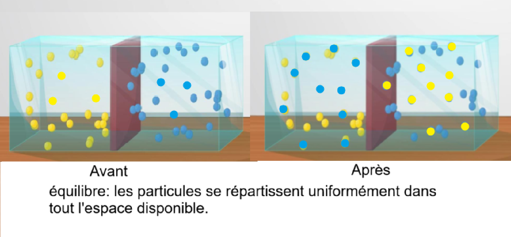
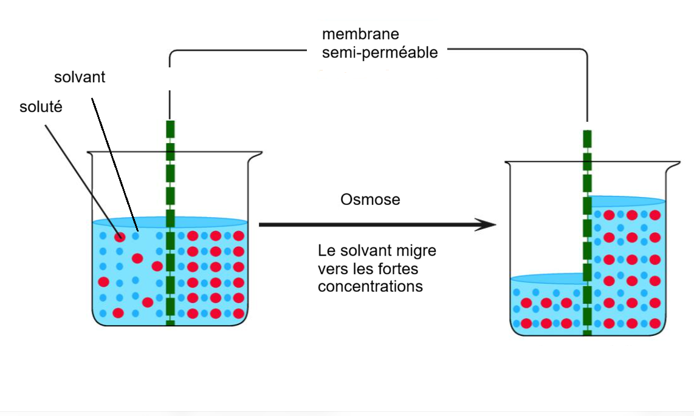
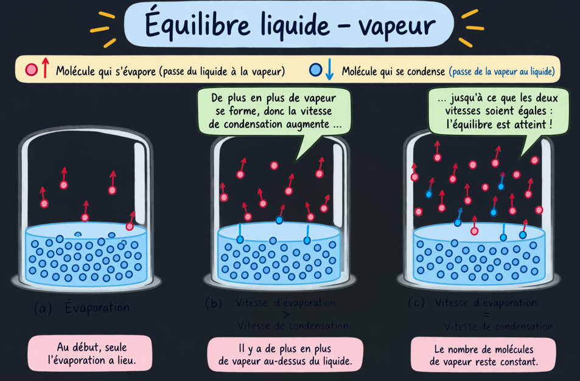
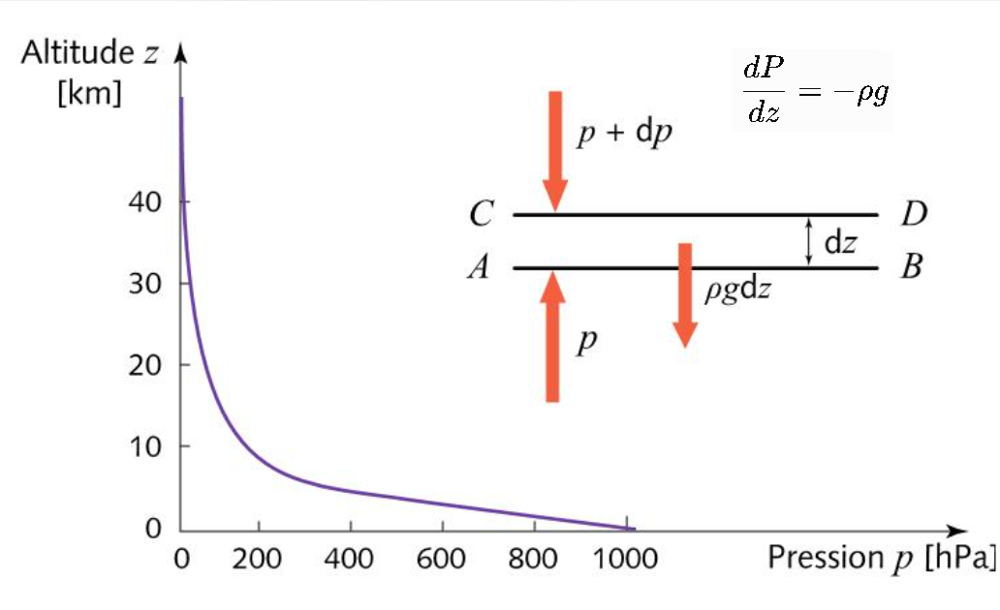

# Cours de thermodynamique statistique : le potentiel chimique et l'équilibre thermodynamique

L'objectif est de comprendre non seulement les équations, mais surtout pourquoi le potentiel chimique est nécessaire, ce qu'il représente physiquement et comment il permet de décrire l'équilibre d'un système.

Nous allons notamment répondre à ces questions :

1. Comment caractériser complètement l'état thermodynamique d'un système ?

2. Pourquoi la température et la pression ne suffisent-elles pas toujours ?

3. Qu'est-ce que le potentiel chimique ?

4. Pourquoi deux systèmes en contact échangent-ils de la matière jusqu'à égalisation de leurs potentiels chimiques ?

5. Comment décrire l'équilibre d'un mélange de plusieurs espèces chimiques ?

6. Comment déterminer les conditions d'équilibre lorsque des réactions chimiques sont possibles ?

## 1. Décrire l'état thermodynamique d'un système

Commençons par un système simple : un gaz contenu dans un récipient.

On peut caractériser son état macroscopique par plusieurs grandeurs :

- $T$ : température ;

- $P$ : pression ;

- $V$ : volume ;

- $N$ : nombre de particules ;

- $U$ : énergie interne ;

- $S$ : entropie.

Ces grandeurs ne sont cependant pas indépendantes.

Pour un gaz parfait classique, par exemple :

$$
PV=Nk_BT
$$

Cette équation d'état relie quatre grandeurs.

Si l'on connaît $N,V,T$, on connaît automatiquement la pression.

Mais attention : cette relation est particulière au gaz parfait. Pour un fluide réel, il faut une équation d'état plus complexe.

## 1.1 Les variables extensives et intensives

Il est utile de distinguer deux catégories de grandeurs.

Grandeurs extensives :

- volume $V$ ;

- énergie $U$ ;

- entropie $S$ ;

- nombre de particules $N$.

Elles sont proportionnelles à la quantité de matière lorsque l'on reproduit un système dans les mêmes conditions.

Grandeurs intensives :

- température $T$ ;

- pression $P$ ;

- potentiel chimique $\mu$ ;

- densité ;

- concentration.

Elles ne dépendent pas directement de la taille du système.

Par exemple, deux litres d'eau à 20 °C et dix litres d'eau à 20 °C ont la même température, mais pas la même énergie interne ni la même entropie.

## 1.2 L'équation fondamentale de la thermodynamique

Voici une relation absolument centrale :

$$
\boxed{
dU=T\,dS-P\,dV+\mu\,dN
}
$$

Pour un système simple constitué d'une seule espèce chimique.

Cette relation exprime comment varie l'énergie interne lorsque l'on modifie :

- l'entropie ;

- le volume ;

- le nombre de particules.

Elle permet déjà de comprendre l'origine du potentiel chimique.

Les trois coefficients ont une signification analogue :

$$
T=\left(\frac{\partial U}{\partial S}\right)_{V,N}
$$

$$
-P=\left(\frac{\partial U}{\partial V}\right)_{S,N}
$$

$$
\boxed{
\mu=\left(\frac{\partial U}{\partial N}\right)_{S,V}
}
$$

Le potentiel chimique est donc, en quelque sorte, le coût énergétique marginal de l'ajout d'une particule, lorsque l'entropie et le volume sont maintenus constants.

C'est une première définition fondamentale.

Attention : ce n'est pas simplement l'énergie d'une particule isolée. Le potentiel chimique tient compte de l'ensemble du système et de ses interactions.

## 2. Pourquoi introduire le potentiel chimique ?

Imaginons deux récipients contenant le même gaz, séparés par une paroi mobile et perméable aux particules.

Les deux récipients peuvent échanger de la matière.

Supposons que leur température et leur pression soient identiques, mais que leurs densités soient différentes.

Il peut alors y avoir un transfert de particules.

La question est : dans quel sens ?

La température nous renseigne sur les échanges d'énergie thermique.

La pression nous renseigne sur les échanges de volume et le travail mécanique.

Mais aucune de ces deux grandeurs ne permet, à elle seule, de déterminer le sens d'un transfert de matière.

Il nous faut une troisième grandeur : le potentiel chimique.

## 2.1 Démonstration de la condition d'équilibre

Considérons deux systèmes A et B qui peuvent échanger des particules.

L'ensemble est isolé, son énergie totale et son nombre total de particules sont conservés :

$$
U_A+U_B=U_{\mathrm{tot}}
$$

$$
N_A+N_B=N_{\mathrm{tot}}
$$

Supposons que les volumes soient fixes.

La variation d'énergie du système A est :

$$
dU_A=T_A dS_A+\mu_A dN_A
$$

Pour B :

$$
dU_B=T_B dS_B+\mu_B dN_B
$$

La conservation de l'énergie et de la matière donne :

$$
dU_B=-dU_A,\qquad dN_B=-dN_A
$$

On peut alors écrire :

$$
dS_{\mathrm{tot}}
= dS_A+dS_B
$$

En utilisant les relations précédentes :

$$
dS_{\mathrm{tot}}
= \left(\frac{1}{T_A}-\frac{1}{T_B}\right)dU_A
+
\left(-\frac{\mu_A}{T_A}
+\frac{\mu_B}{T_B}\right)dN_A
$$

À l'équilibre, l'entropie totale est maximale.

Elle ne doit donc plus varier au premier ordre, quelle que soit la variation infinitésimale autorisée.

On obtient deux conditions :

$$
\boxed{T_A=T_B}
$$

et

$$
\boxed{\mu_A=\mu_B}
$$

Voilà un résultat fondamental.

L'équilibre thermique impose l'égalité des températures. L'équilibre de diffusion impose l'égalité des potentiels chimiques.

Et si les deux systèmes peuvent également échanger du volume, une troisième condition apparaît :

$$
\boxed{P_A=P_B}
$$

Nous retrouvons ainsi les trois grandes conditions d'équilibre thermodynamique.

## 3. Le potentiel chimique en physique statistique

Nous allons maintenant retrouver le potentiel chimique à partir de la mécanique statistique.

C'est intéressant parce que cela donne une interprétation microscopique à cette grandeur.

## 3.1 L'ensemble grand canonique

Jusqu'ici, nous avons imaginé un système dont le nombre de particules pouvait varier.

C'est précisément ce que décrit l'ensemble grand canonique.

On considère un système :

- en contact avec un thermostat à température $T$ ;

- en contact avec un réservoir de particules de potentiel chimique $\mu$ ;

- maintenu dans un volume $V$.

Le système peut donc échanger de l'énergie et des particules avec son environnement.

La probabilité d'un micro-état $i$, contenant $N$ particules et d'énergie $E_i$, est :

$$
\boxed{
p_i=\frac{1}{\mathcal Z}
e^{-\beta(E_i-\mu N)}
}
$$

avec :

$$
\beta=\frac{1}{k_BT}
$$

et $\mathcal Z$ la fonction de partition grand canonique :

$$
\boxed{
\mathcal Z=
\sum_N\sum_i e^{-\beta(E_i-\mu N)}
}
$$

Le terme essentiel est :

$$
E_i-\mu N
$$

Il représente l'énergie du système corrigée du coût associé à la présence de ses particules.

Le potentiel chimique joue donc le rôle d'un paramètre qui contrôle les échanges de particules avec le réservoir.

On peut d'ailleurs retrouver le nombre moyen de particules par :

$$
\boxed{
\langle N\rangle=
\frac{1}{\beta}
\frac{\partial \ln\mathcal Z}{\partial\mu}
}
$$

Et réciproquement :

$$
\boxed{
\mu=
-\left(\frac{\partial \Omega}{\partial N}\right)_{T,V}
}
$$

où $\Omega$ est le grand potentiel thermodynamique :

$$
\Omega=-k_BT\ln\mathcal Z
$$

Il s'agit de l'analogue du potentiel de Gibbs ou de Helmholtz, adapté à un système dont le nombre de particules est variable.

## 3.2 Exemple : le gaz parfait classique

Prenons un gaz parfait monoatomique classique.

On connaît sa fonction de partition canonique :

$$
Z_N=\frac{1}{N!}
\left(\frac{V}{\lambda_T^3}\right)^N
$$

où :

$$
\lambda_T=
\frac{h}{\sqrt{2\pi m k_BT}}
$$

est la longueur d'onde thermique de de Broglie.

La fonction de partition grand canonique devient :

$$
\mathcal Z=
\sum_{N=0}^{\infty}e^{\beta\mu N}Z_N
$$

En remplaçant :

$$
\mathcal Z=
\sum_{N=0}^{\infty}
\frac{1}{N!}
\left(
\frac{Ve^{\beta\mu}}{\lambda_T^3}
\right)^N
$$

On reconnaît le développement de l'exponentielle :

$$
\boxed{
\mathcal Z=
\exp\left(
\frac{Ve^{\beta\mu}}{\lambda_T^3}
\right)
}
$$

Le nombre moyen de particules vaut alors :

$$
\langle N\rangle=
\frac{Ve^{\beta\mu}}{\lambda_T^3}
$$

En introduisant la densité :

$$
n=\frac{\langle N\rangle}{V}
$$

nous obtenons :

$$
n=\frac{e^{\beta\mu}}{\lambda_T^3}
$$

Finalement :

$$
\boxed{
\mu=k_BT\ln(n\lambda_T^3)
}
$$

C'est une formule particulièrement intéressante.

Elle montre que, pour un gaz parfait classique, le potentiel chimique dépend de deux paramètres :

- la température ;

- la densité de particules.

En utilisant l'équation des gaz parfaits, $P=nk_BT$, on peut aussi écrire :

$$
\boxed{
\mu=k_BT\ln\left(
\frac{P\lambda_T^3}{k_BT}
\right)
}
$$

Résultat important

À température identique, le potentiel chimique augmente avec la densité.

Deux gaz parfaits à la même température mais de densités différentes ne sont donc pas en équilibre de diffusion.

Les particules tendent à passer du milieu de potentiel chimique élevé vers celui de potentiel chimique faible.

Attention toutefois : cette dernière formulation suppose des conditions de température identiques et l'absence d'autres forces agissant sur les particules.

## 4. Comment caractériser l'équilibre d'un système ?

Nous pouvons maintenant construire une description générale.

Pour un système constitué d'une seule espèce, les variables thermodynamiques fondamentales sont :

$$
\boxed{U,\ S,\ V,\ N}
$$

L'énergie interne peut être considérée comme une fonction :

$$
U=U(S,V,N)
$$

Les variables intensives sont alors obtenues par dérivation :

$$
\boxed{
T=\left(\frac{\partial U}{\partial S}\right)_{V,N}
}
$$

$$
\boxed{
P=-\left(\frac{\partial U}{\partial V}\right)_{S,N}
}
$$

$$
\boxed{
\mu=\left(\frac{\partial U}{\partial N}\right)_{S,V}
}
$$

Autrement dit, la fonction $U(S,V,N)$ contient toute l'information thermodynamique du système.

On peut aussi utiliser d'autres potentiels thermodynamiques selon les contraintes imposées.

## 4.1 Les quatre grands potentiels thermodynamiques

| Potentiel       | Définition  | Variables naturelles |
| --------------- | ----------- | -------------------- |
| Énergie interne | $U$         | $S,V,N$              |
| Enthalpie       | $H=U+PV$    | $S,P,N$              |
| Helmholtz       | $F=U-TS$    | $T,V,N$              |
| Gibbs           | $G=U-TS+PV$ | $T,P,N$              |

Ces transformations ne sont pas de simples changements de notation.

Elles permettent de choisir le potentiel dont les variables correspondent aux conditions expérimentales.

Par exemple :

- système isolé : on maximise l'entropie $S$, à énergie, volume et quantité de matière fixés ;

- système à température et volume imposés : on minimise l'énergie libre de Helmholtz $F$ ;

- système à température et pression imposées : on minimise l'énergie libre de Gibbs $G$.

Pour ce dernier cas :

$$
\boxed{
dG=-S\,dT+V\,dP+\mu\,dN
}
$$

Si la température et la pression sont constantes :

$$
\boxed{dG=\mu\,dN}
$$

Cette relation est particulièrement utile pour les réactions chimiques et les changements de phase.

## 4.2 Le cas de plusieurs espèces chimiques

C'est ici que les choses deviennent vraiment intéressantes.

Imaginons un mélange contenant plusieurs espèces :

$$
A,\quad B,\quad C,\quad \ldots
$$

Chacune possède son propre nombre de particules $N_i$ et son propre potentiel chimique $\mu_i$.

L'équation fondamentale devient :

$$
\boxed{
dU=T\,dS-P\,dV+\sum_i\mu_i\,dN_i
}
$$

Le potentiel chimique est donc une grandeur propre à chaque espèce chimique, dans un environnement donné.

Il dépend notamment :

- de la température ;

- de la pression ;

- de la concentration de cette espèce ;

- de la nature des autres espèces présentes ;

- des interactions entre les constituants.

Pour un mélange idéal de gaz parfaits :

$$
\boxed{
\mu_i(T,P_i)=
\mu_i^\circ(T)+
k_BT\ln\left(\frac{P_i}{P^\circ}\right)
}
$$

Ici, $P_i$ est la pression partielle de l'espèce $i$, et $P^\circ$ une pression de référence.

Pour une solution idéale, on utilise une expression analogue avec la fraction molaire ou l'activité.

Dans le cas général, on écrit :

$$
\boxed{
\mu_i=\mu_i^\circ+RT\ln a_i
}
$$

où $a_i$ est l'activité thermodynamique, sans dimension.

Cette relation est écrite à l'échelle molaire. À l'échelle d'une particule, on utilise $k_B T$ à la place de $RT$, avec $R=N_Ak_B$.

L'activité est une concentration effective qui tient compte des écarts à l'idéalité.

## 5. Équilibre d'un mélange : les conditions à satisfaire

Prenons deux compartiments A et B contenant un mélange de plusieurs espèces chimiques.

Ils peuvent échanger de l'énergie, du volume et des particules.

À l'équilibre thermodynamique :

Équilibre thermique :

$$
T_A=T_B
$$

Équilibre mécanique :

$$
P_A=P_B
$$

Équilibre chimique ou de diffusion :

$$
\boxed{
\mu_{i,A}=\mu_{i,B}
\qquad\forall i
}
$$

C'est cette dernière relation qui est la plus générale.

Elle signifie que chaque espèce chimique doit avoir le même potentiel chimique de part et d'autre de la séparation qui lui permet de diffuser.

Attention : si une membrane est sélective et ne laisse passer que certaines espèces, l'égalité ne concerne que ces espèces perméantes.

## 5.1 Un exemple : deux gaz séparés par une membrane

Imaginons deux compartiments contenant un gaz parfait à température identique.

À l'équilibre de diffusion :

$$
\mu_A=\mu_B
$$

Or :

$$
\mu=k_BT\ln(n\lambda_T^3)
$$

La température étant identique, la longueur d'onde thermique est identique.

Donc :

$$
\ln(n_A\lambda_T^3)
= \ln(n_B\lambda_T^3)
$$

D'où :

$$
\boxed{n_A=n_B}
$$

La densité est donc uniforme à l'équilibre.

Mais attention : cela n'implique pas nécessairement que les quantités totales de gaz dans les deux compartiments soient identiques, car leurs volumes peuvent être différents.

## 5.2 Osmose et équilibre du solvant

Considérons deux solutions séparées par une membrane qui laisse passer le solvant, mais pas le soluté. Le solvant diffuse vers la solution où son potentiel chimique est le plus faible, jusqu'à l'égalité de ses potentiels chimiques de part et d'autre.

La pression hydrostatique dans la solution concentrée augmente au fur et à mesure que le solvant y entre. À l'équilibre, cette différence de pression compense la différence de potentiel chimique due à la concentration.

Prenons de l'eau pure dans le compartiment A et une solution aqueuse de chlorure de sodium dans le compartiment B. À température fixée, l'équilibre des potentiels chimiques de l'eau s'écrit :

$$
\mu_{\mathrm{eau}}(T,P)
=
\mu_{\mathrm{eau}}(T,P+\Delta P)+RT\ln x_{\mathrm{eau}}
$$

où $P$ est la pression dans le compartiment A et $P+\Delta P$ celle dans le compartiment B. La fraction molaire de l'eau dans la solution vaut

$$
x_{\mathrm{eau}}
=\frac{n_{\mathrm{eau}}}{n_{\mathrm{eau}}+n_{\mathrm{sel}}}
=\frac{1}{1+n_{\mathrm{sel}}/n_{\mathrm{eau}}}
$$

Ici, $n_{\mathrm{sel}}=n_{\mathrm{Na^+}}+n_{\mathrm{Cl^-}}$ est la quantité de matière totale d'ions dissous. Dans la limite diluée, $n_{\mathrm{sel}}/n_{\mathrm{eau}}\ll 1$, donc

$$
\ln x_{\mathrm{eau}}
=-\ln\left(1+\frac{n_{\mathrm{sel}}}{n_{\mathrm{eau}}}\right)
\simeq -\frac{n_{\mathrm{sel}}}{n_{\mathrm{eau}}}
$$

Pour une faible différence de pression, le potentiel chimique de l'eau varie selon

$$
\mu_{\mathrm{eau}}(T,P+\Delta P)
\simeq
\mu_{\mathrm{eau}}(T,P)+\bar V_{\mathrm{eau}}\,\Delta P
$$

où $\bar V_{\mathrm{eau}}\simeq V/n_{\mathrm{eau}}$ est le volume molaire de l'eau, et $V$ le volume de la solution. En reportant ces approximations dans la condition d'équilibre, on obtient

$$
\Delta P
\simeq
RT\,\frac{n_{\mathrm{sel}}}{n_{\mathrm{eau}}}\,
\frac{n_{\mathrm{eau}}}{V}
=RT\,\frac{n_{\mathrm{sel}}}{V}
=2cRT
$$

où $c=n_{\mathrm{Na^+}}/V=n_{\mathrm{Cl^-}}/V$ est la concentration molaire de chaque ion. La différence de pression $\Delta P$ correspond à la pression osmotique $\Pi$.

Pour une solution diluée idéale, la pression osmotique vérifie la loi de van 't Hoff :

$$
\Pi \simeq RT\sum_i c_i
$$

où $c_i$ est la concentration molaire de chaque espèce dissoute. Pour une seule espèce, on retrouve $\Pi\simeq cRT$. Si le chlorure de sodium est complètement dissocié, les ions $\mathrm{Na^+}$ et $\mathrm{Cl^-}$ contribuent chacun à la pression osmotique, d'où $\Pi\simeq 2cRT$. Cette relation montre que l'osmose est une conséquence directe de l'égalité des potentiels chimiques, et non une force distincte.

****************************************************************************

En résumé, la formule générale est :

$$
\mu_i=\mu_i^\circ+RT\ln a_i
$$

où $\mu_i^\circ$ est le potentiel chimique molaire standard et $a_i$ l'activité thermodynamique, sans dimension, qui dépend du modèle utilisé.

| Système                        | Activité $a_i$ | Potentiel chimique molaire       |
| ------------------------------ | -------------- | -------------------------------- |
| Gaz parfait                    | $P_i/P^\circ$  | $\mu_i^\circ+RT\ln(P_i/P^\circ)$ |
| Soluté dilué idéal             | $c_i/c^\circ$  | $\mu_i^\circ+RT\ln(c_i/c^\circ)$ |
| Constituant d'un liquide idéal | $x_i$          | $\mu_i^\circ+RT\ln x_i$          |

Les pressions et concentrations de référence sont $P^\circ=1\,\mathrm{bar}$ et $c^\circ=1\,\mathrm{mol\,L^{-1}}$. Ce sont des états standards conventionnels ; les rapports dans les logarithmes sont ainsi sans dimension.

Les états standards associés à $\mu_i^\circ$ dépendent du modèle :

- gaz : état standard à la pression $P^\circ$ ;

- soluté : état standard défini par convention, souvent extrapolé à dilution infinie ;

- liquide idéal : constituant pur à la température et à la pression considérées.

Pour un mélange de gaz parfaits, la pression partielle vérifie $P_i=x_iP$. Donc :

$$
\mu_i=\mu_i^\circ(T)+RT\ln x_i+RT\ln\left(\frac{P}{P^\circ}\right)
$$

À température et pression totales fixées, le dernier terme peut être incorporé dans un potentiel chimique standard défini à cette pression.

****************************************************************************

## 5.3 Les changements de phase

Le potentiel chimique permet également de comprendre pourquoi deux phases peuvent coexister.

Prenons de l'eau liquide en contact avec sa vapeur.

À l'équilibre :

$$
\boxed{
\mu_{\mathrm{liquide}}=
\mu_{\mathrm{vapeur}}
}
$$

Si les potentiels chimiques sont différents, des molécules passent préférentiellement d'une phase à l'autre.

La température et la pression déterminent les potentiels chimiques des deux phases.

La coexistence devient possible lorsque ceux-ci sont égaux.

C'est ainsi que l'on décrit thermodynamiquement l'équilibre liquide-vapeur, mais aussi les équilibres solide-liquide et solide-vapeur.

## 6. Équilibre des réactions chimiques

C'est probablement l'une des applications les plus importantes du potentiel chimique.

Imaginons une réaction :

$$
A+B\rightleftharpoons C
$$

Les nombres de particules ne sont plus individuellement conservés.

En revanche, ils varient suivant les coefficients stœchiométriques de la réaction.

On peut introduire une variable $\xi$, appelée avancement de réaction :

$$
dN_A=-d\xi
$$

$$
dN_B=-d\xi
$$

$$
dN_C=+d\xi
$$

À température et pression constantes :

$$
dG=\mu_A dN_A+\mu_B dN_B+\mu_C dN_C
$$

Donc :

$$
dG=(-\mu_A-\mu_B+\mu_C)d\xi
$$

À l'équilibre, $G$ est minimal :

$$
\boxed{
\mu_C-\mu_A-\mu_B=0
}
$$

Autrement dit :

$$
\boxed{
\mu_C=\mu_A+\mu_B
}
$$

Voilà une condition générale d'équilibre chimique.

Pour une réaction plus générale :

$$
\sum_i\nu_i A_i=0
$$

où les coefficients $\nu_i$ sont positifs pour les produits et négatifs pour les réactifs :

$$
\boxed{
\sum_i\nu_i\mu_i=0
}
$$

Cette formule est extrêmement puissante.

Elle permet de déterminer la composition d'équilibre d'un mélange chimique à partir des potentiels chimiques des espèces présentes.

## 6.1 Lien avec la constante d'équilibre

Pour des espèces idéales :

$$
\mu_i=\mu_i^\circ+RT\ln a_i
$$

En introduisant cette expression dans la condition d'équilibre :

$$
\sum_i\nu_i\mu_i=0
$$

on obtient :

$$
\sum_i\nu_i\mu_i^\circ+
RT\sum_i\nu_i\ln a_i=0
$$

Soit :

$$
\Delta_rG^\circ+RT\ln Q=0
$$

À l'équilibre, $Q=K$, d'où :

$$
\boxed{
K=\exp\left(-\frac{\Delta_rG^\circ}{RT}\right)
}
$$

Nous retrouvons ainsi la relation entre l'énergie libre de réaction et la constante d'équilibre chimique.

Le potentiel chimique relie donc directement la thermodynamique, la physique statistique et la chimie.

## 7. Équilibre thermodynamique dans un système spatialement étendu

J'aimerais insister sur un point important, notamment pour les systèmes physiques dans lesquels les grandeurs thermodynamiques ne sont pas uniformes.

Jusqu'ici, nous avons considéré des compartiments homogènes, chacun caractérisé par une température, une pression et des potentiels chimiques.

Mais dans un système étendu, ces grandeurs peuvent dépendre de la position :

$$
T=T(\mathbf r)
$$

$$
P=P(\mathbf r)
$$

$$
\mu_i=\mu_i(\mathbf r)
$$

Il faut alors distinguer deux notions.

## 7.1 Équilibre thermodynamique global

En l'absence de forces extérieures et à l'équilibre thermodynamique véritable :

$$
\boxed{T(\mathbf r)=T_0}
$$

La température est uniforme.

De même, pour une espèce qui peut diffuser librement :

$$
\boxed{\mu_i(\mathbf r)=\mu_{i,0}}
$$

En revanche, la pression n'est pas nécessairement uniforme lorsqu'il existe des forces volumiques.

## 7.2 Exemple : un gaz dans un champ gravitationnel

Considérons un gaz dans le champ de gravitation terrestre.

À l'équilibre, les particules subissent leur poids, mais leur distribution spatiale doit également tenir compte de l'agitation thermique.

Pour une particule de masse $m$, l'énergie potentielle gravitationnelle est :

$$
E_p(z)=mgz
$$

À l'équilibre, ce n'est pas le potentiel chimique seul qui est uniforme, mais :

$$
\boxed{
\mu(z)+mgz=\text{constante}
}
$$

Pour un gaz parfait :

$$
\mu(z)=k_BT\ln(n(z)\lambda_T^3)
$$

La température étant uniforme, on obtient :

$$
k_BT\ln(n(z)\lambda_T^3)+mgz
=\text{constante}
$$

Donc :

$$
\boxed{
n(z)=n(0)e^{-mgz/(k_BT)}
}
$$

Nous retrouvons la distribution barométrique de l'atmosphère.

C'est un résultat remarquable : une densité non uniforme peut parfaitement correspondre à un équilibre thermodynamique.

La gravitation compense le gradient de potentiel chimique.

La pression suit également un gradient :

$$
\boxed{
\frac{dP}{dz}=-\rho g
}
$$

C'est l'équation hydrostatique.

Une remarque importante: dans un gaz soumis à sa propre gravitation, il faudra remplacer $mgz$ par l'énergie potentielle gravitationnelle locale $m\Phi(\mathbf r)$. À l'équilibre :

$$
\mu(\mathbf r)+m\Phi(\mathbf r)=\text{constante}
$$

et le potentiel gravitationnel doit lui-même satisfaire l'équation de Poisson :

$$
\boxed{
\nabla^2\Phi=4\pi G\rho
}
$$

On obtient ainsi un problème couplé entre distribution des particules et champ gravitationnel.

C'est précisément le genre de système où le potentiel chimique devient très utile.

Il faut néanmoins être prudent : les systèmes autogravitants ont des propriétés particulières, notamment des problèmes de stabilité et d'équivalence des ensembles statistiques.

## 7.3 Et si la température n'est pas uniforme ?

Un gradient de température signifie généralement que le système n'est pas à l'équilibre thermique global.

Il peut cependant être dans un état de quasi-équilibre local.

On peut alors définir localement :

$$
T(\mathbf r),\quad
P(\mathbf r),\quad
\mu_i(\mathbf r)
$$

et utiliser les relations thermodynamiques locales, à condition que les échelles de temps et de longueur permettent de définir un état thermodynamique local.

C'est le point de départ de la thermodynamique hors équilibre et des phénomènes de transport :

- conduction thermique ;

- diffusion de matière ;

- viscosité ;

- réactions chimiques ;

- rayonnement.

Un gradient de potentiel chimique peut provoquer un flux de matière, tout comme un gradient de température peut provoquer un flux de chaleur.

## 8. Synthèse : comment déterminer l'équilibre d'un système ?

Voici le tableau à conserver comme référence:

| Phénomène                       | Condition d'équilibre            |
| ------------------------------- | -------------------------------- |
| Échange de chaleur              | $T_A=T_B$                        |
| Échange de volume               | $P_A=P_B$                        |
| Diffusion d'une espèce $i$      | $\mu_{i,A}=\mu_{i,B}$            |
| Changement de phase             | $\mu_\alpha=\mu_\beta$           |
| Réaction chimique               | $\sum_i\nu_i\mu_i=0$             |
| Diffusion sous force extérieure | $\mu_i+E_{p,i}=\text{constante}$ |

Ces conditions sont à appliquer en tenant compte des contraintes et des échanges effectivement autorisés.

## La vision générale

Les trois grandeurs fondamentales des échanges thermodynamiques

Température $T$

Contrôle les échanges d'énergie thermique.

Pression $P$

Contrôle les échanges mécaniques et les variations de volume.

Potentiel chimique $\mu_i$

Contrôle les échanges de matière et les transformations chimiques.

Une formulation encore plus générale consiste à dire que l'équilibre thermodynamique est atteint lorsque le potentiel thermodynamique approprié atteint son minimum, sous les contraintes imposées au système.

C'est finalement le principe unificateur derrière toutes les conditions que nous avons établies.
